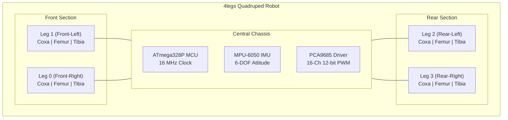
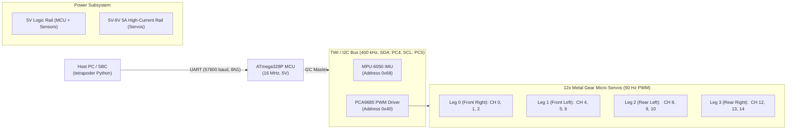
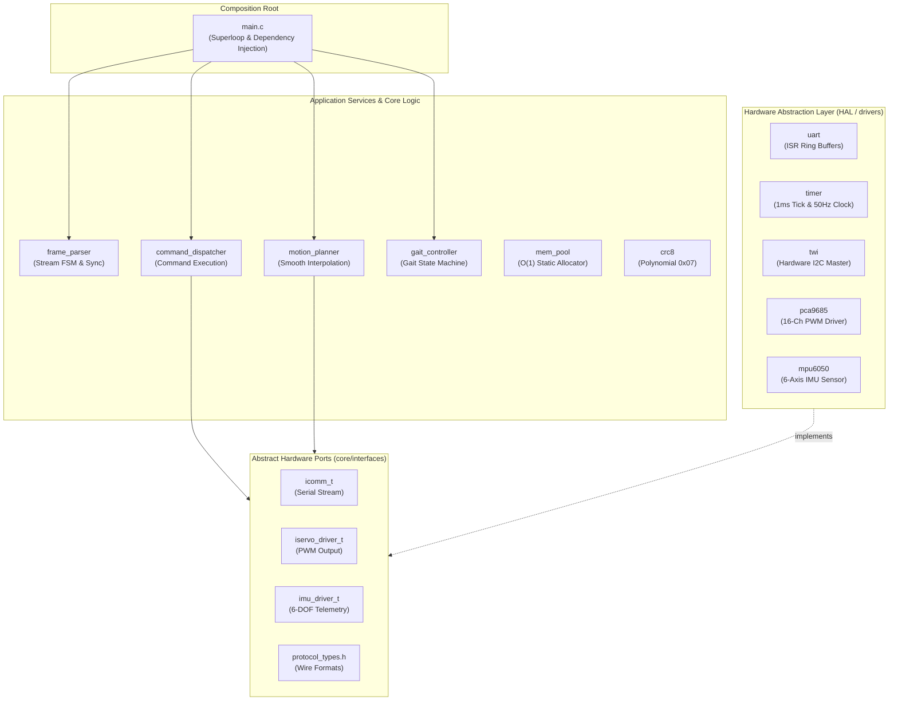
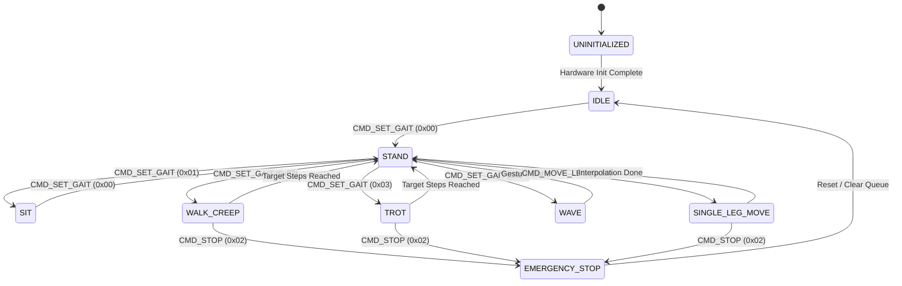
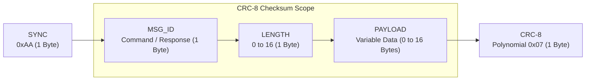
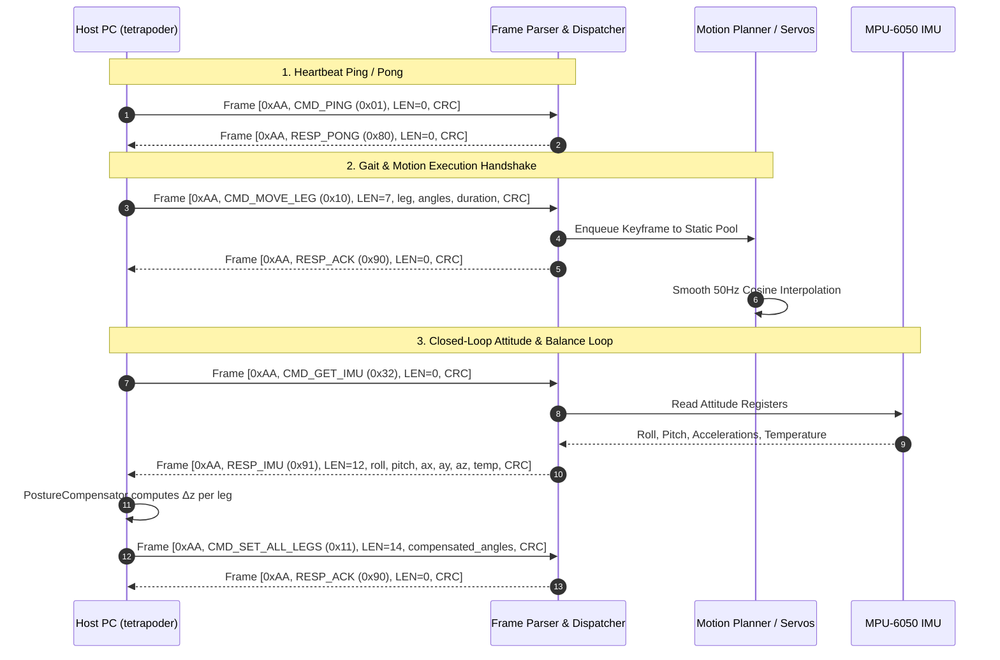

# 4legs — Quadruped Robot Embedded Firmware & Control Architecture


**4legs** is a modular, high-reliability embedded firmware and hardware control framework for a 12-DOF (degree-of-freedom) quadruped / spider robot based on the **Microchip AVR ATmega328P** microcontroller.

The firmware is developed in **100% bare-metal C** adhering to **Clean Architecture**, **SOLID principles**, and **MISRA-C:2012 / 2023** deterministic embedded standards: zero dynamic memory allocation, bounded loops, lock-free ring buffers, and CRC-8 integrity verification on all serial communication.

[]()
[](https://www.microchip.com/en-us/product/ATmega328P)
[-orange.svg)](https://en.wikipedia.org/wiki/C_(programming_language))
[](https://4legs.readthedocs.io/projects/4legs/en/latest/?badge=latest)
[](https://www.gnu.org/licenses/gpl-3.0)

---

<!-- START doctoc generated TOC please keep comment here to allow auto update -->
<!-- DON'T EDIT THIS SECTION, INSTEAD RE-RUN doctoc TO UPDATE -->
**Table of Contents**

- [Key Features](#key-features)
- [Hardware Architecture & Electrical Topology](#hardware-architecture--electrical-topology)
  - [Bill of Materials](#bill-of-materials)
- [Firmware Architecture](#firmware-architecture)
- [Motion State Machine](#motion-state-machine)
- [Binary Wire Protocol & Communication Flows](#binary-wire-protocol--communication-flows)
  - [Wire Frame Anatomy](#wire-frame-anatomy)
  - [Interactive Communication Sequences](#interactive-communication-sequences)
  - [Command Set (Host $\to$ Robot)](#command-set-host-%5Cto-robot)
  - [Response Set (Robot $\to$ Host)](#response-set-robot-%5Cto-host)
- [Prerequisites & Toolchain](#prerequisites--toolchain)
- [Compilation & Flashing](#compilation--flashing)
  - [1. Compile Firmware Binary](#1-compile-firmware-binary)
  - [2. Flash to ATmega328P](#2-flash-to-atmega328p)
- [Host Integration (tetrapoder)](#host-integration-tetrapoder)
  - [Installation](#installation)
  - [Modes of Operation](#modes-of-operation)
- [Repository Structure](#repository-structure)
- [Documentation & References](#documentation--references)
- [Copyright & License](#copyright--license)

<!-- END doctoc generated TOC please keep comment here to allow auto update -->

---

## Overview & Robotics Design

Quadruped locomotion requires coordinated multi-axis kinematics, smooth trajectory interpolation, and real-time attitude stabilization. **4legs** implements the low-level embedded real-time firmware that drives the robot actuators, reads inertial sensors, and communicates with higher-level planning software over an asynchronous binary protocol.



Each leg comprises 3 degrees of freedom:
1. **Coxa (Joint 0)**: Horizontal hip yaw/abduction ($\pm 45^\circ$).
2. **Femur (Joint 1)**: Vertical thigh pitch ($-60^\circ$ to $+60^\circ$).
3. **Tibia (Joint 2)**: Vertical knee pitch ($-90^\circ$ to $+30^\circ$).

---

## Key Features

- **Bare-metal AVR Execution**: Optimized for ATmega328P clocked at 16.0 MHz (5V logic).
- **Clean Architecture & Ports/Adapters**: Hardware registers and low-level drivers (`uart`, `twi`, `pca9685`, `mpu6050`) are fully decoupled from core motion planning and command dispatching via polymorphic interfaces.
- **MISRA-C Determinism**: Zero dynamic memory allocation (`malloc`/`free` strictly forbidden). Static memory pool (`mem_pool`) for motion keyframes with $O(1)$ allocation/deallocation.
- **16-Channel 12-bit Servo Control**: Hardware I2C / TWI interface to **PCA9685** PWM controller delivering jitter-free 50 Hz servo pulses with microsecond resolution.
- **6-DOF IMU Telemetry & Attitude Estimation**: Integrated **MPU-6050** driver running a digital low-pass filter (DLPF 44 Hz) and onboard attitude estimation calculating pitch and roll tilt angles in integer tenths of a degree ($0.1^\circ$).
- **Robust Binary Protocol**: Packet framing with `0xAA` synchronization, sequence numbering, payload lengths, and **CRC-8** (polynomial `0x07`, ATM/SMBus) integrity checking.
- **Dual Safety Watchdogs**: Microcontroller hardware Watchdog Timer (WDT) and software motion timeout supervision to guarantee robot safety in case of connection loss.

---

## Hardware Architecture & Electrical Topology



### Bill of Materials

| Component | Description | Interface / Notes |
|---|---|---|
| **MCU** | Microchip ATmega328P (16 MHz crystal, 5V) | Arduino Nano / Pro Mini or custom PCB |
| **PWM Driver** | NXP PCA9685 16-Channel 12-bit PWM Controller | I2C (address `0x40`), 50 Hz servo refresh |
| **IMU Sensor** | InvenSense MPU-6050 (6-axis gyro + accelerometer) | I2C (address `0x68`), onboard DLPF filter |
| **Servos** | 12x MG90S (Metal Gear) or SG90 Micro Servos | 3 servos per leg $\times$ 4 legs |
| **Power Supply** | Dual-rail power: 5V logic & dedicated 5V/6V 4A+ BEC | High current rail isolated for servo inductive loads |
| **Communication** | Hardware UART / USB-to-UART bridge (CH340/FT232) | 57600 baud, 8N1 |

---

## Firmware Architecture

Dependencies strictly flow from the outside inwards:
`drivers/` $\longrightarrow$ `core/interfaces/` $\longleftarrow$ `core/domain`.



---

## Motion State Machine



---

## Binary Wire Protocol & Communication Flows

### Wire Frame Anatomy



- **SYNC**: Constant start delimiter `0xAA` (170 dec).
- **MSG_ID**: 1-byte command or response identifier.
- **LENGTH**: 1-byte payload size ($0 \le N \le 16$).
- **PAYLOAD**: Variable binary data payload.
- **CRC-8**: 1-byte checksum computed over `[MSG_ID, LENGTH, PAYLOAD...]` using polynomial $x^8 + x^2 + x^1 + x^0$ (`0x07`).

### Interactive Communication Sequences



### Command Set (Host $\to$ Robot)

| Command ID | Identifier | Payload Format | Description |
|---|---|---|---|
| `0x01` | `CMD_PING` | Empty | Heartbeat request, expects `RESP_PONG`. |
| `0x02` | `CMD_STOP` | Empty | Emergency stop, halts ongoing motion. |
| `0x10` | `CMD_MOVE_LEG` | `leg_idx`(u8), `coxa`(i16), `femur`(i16), `tibia`(i16), `duration`(u16) | Move single leg joints to target angles ($0.1^\circ$). |
| `0x11` | `CMD_SET_ALL_LEGS` | 12 $\times$ angles (i16), `duration`(u16) | Coordinate target pose for all 4 legs simultaneously. |
| `0x20` | `CMD_SET_GAIT` | `gait_id`(u8): `0x00` Stand, `0x01` Sit, `0x02` Walk, `0x03` Trot, `0x04` Wave | Switch onboard autonomous gait generator. |
| `0x21` | `CMD_SET_SPEED` | `multiplier`(u8, 1..10) | Adjust motion execution speed factor. |
| `0x32` | `CMD_GET_IMU` | Empty | Request real-time 6-DOF IMU attitude and telemetry. |

### Response Set (Robot $\to$ Host)

| Response ID | Identifier | Payload Format | Description |
|---|---|---|---|
| `0x80` | `RESP_PONG` | Empty | Heartbeat reply confirming online state. |
| `0x90` | `RESP_ACK` | Empty | Command parsed, verified, and enqueued. |
| `0x91` | `RESP_IMU` | 12 bytes big-endian: `roll`(i16), `pitch`(i16), `ax`(i16), `ay`(i16), `az`(i16), `temp`(i16) | 6-DOF attitude and accelerometer telemetry. |
| `0xFF` | `RESP_NACK` | `error_code`(u8) | Checksum error, buffer overflow, or invalid parameter. |

---

## Prerequisites & Toolchain

On Debian / Ubuntu:
```bash
sudo apt-get update
sudo apt-get install -y gcc-avr binutils-avr avr-libc avrdude make python3 python3-pip
```

Verify compiler installation:
```bash
avr-gcc --version
```

---

## Compilation & Flashing

### 1. Compile Firmware Binary
Navigate to the build directory and invoke `make`:
```bash
cd sw/4legs/build
make clean
make
```

Output artifacts generated:
- `4legs.hex`: Intel Hex file for flashing to MCU program memory.
- `4legs.elf`: Executable and Linkable Format binary with debugging symbols.
- `4legs.map`: Memory layout map showing exact flash and SRAM usage.
- `4legs.lss`: Disassembly listing for timing and instruction verification.

### 2. Flash to ATmega328P

Using Arduino bootloader over USB serial:
```bash
avrdude -v -p m328p -c arduino -P /dev/ttyUSB0 -b 57600 -D -U flash:w:4legs.hex:i
```

Or using an external In-System Programmer (USBasp):
```bash
avrdude -v -p m328p -c usbasp -U flash:w:4legs.hex:i
```

---

## Host Integration (tetrapoder)

The companion Python toolkit **`tetrapoder`** provides inverse kinematics, gait planning, trajectory compilation, telemetry decoding, and closed-loop balance stabilization.

### Installation
```bash
cd /data/dev/python/3_tools/tetrapoder/github/tetrapoder
pip install -e .
```

### Modes of Operation

1. **Live Serial Execution (Online Mode)**:
   ```bash
   # Test serial heartbeat:
   tetrapoder --action ping --port /dev/ttyUSB0 --baud 57600

   # Execute walk gait directly on robot:
   tetrapoder --action run --gait walk --port /dev/ttyUSB0

   # Command robot to sit:
   tetrapoder --action run --gait sit --port /dev/ttyUSB0
   ```

2. **Offline Binary Compilation (Batch Export)**:
   ```bash
   # Compile 100-step choreography to standalone .bin file:
   tetrapoder --action compile --gait walk --output walk_plan.bin
   ```

3. **Closed-Loop Balance Feedback (Python API)**:
   ```python
   from tetrapoder.core.service.telemetry.decoder import TelemetryDecoder
   from tetrapoder.core.service.stabilizer.compensator import PostureCompensator
   from tetrapoder.infrastructure.transport.serial import SerialTransport

   transport = SerialTransport(port='/dev/ttyUSB0', baudrate=57600)
   transport.open()

   # Request IMU attitude
   transport.write(b'\xAA\x32\x00\x3A')
   response = transport.read(16)
   telemetry = TelemetryDecoder().decode(response[3:15])

   # Compensate leg height according to chassis tilt
   compensator = PostureCompensator(chassis_length=120.0, chassis_width=90.0)
   for leg in range(4):
       offset = compensator.compute_offset(leg_index=leg, roll_deg=telemetry.roll, pitch_deg=telemetry.pitch)
       print(f'Leg {leg}: vertical adjustment Δz = {offset.z:.2f} mm')
   ```

---

## Repository Structure

```
4legs/
├── build/                 # Global build scripts and compiler definitions
├── docs/                  # Sphinx documentation source and assets
│   ├── source/
│   │   ├── conf.py        # Sphinx build configuration
│   │   └── index.rst      # Master Sphinx documentation entrypoint
├── hw/                    # Mechanical 3D models (STL) and schematics
│   └── body/              # MG90S chassis, hinges, femur, and tibia STLs
├── sw/
│   ├── protocol.md        # Comprehensive protocol & wire specification
│   └── 4legs/             # Firmware C source code
│       ├── build/         # Makefiles and compilation recipes
│       ├── core/
│       │   ├── command_parser/ # Frame decoding & command dispatcher
│       │   ├── crc8/           # Polynomial 0x07 tableless CRC calculation
│       │   ├── interfaces/     # Hardware abstract ports (iimu, iservo, icomm)
│       │   ├── mem_pool/       # Deterministic static chunk memory allocator
│       │   ├── motion/         # Motion planner & gait controller FSM
│       │   └── ring_buffer/    # Lock-free SPSC circular buffers for ISRs
│       ├── drivers/
│       │   ├── mpu6050/        # InvenSense MPU-6050 I2C IMU driver
│       │   ├── pca9685/        # NXP PCA9685 16-channel PWM servo driver
│       │   ├── timer/          # 1 ms system tick and 50 Hz motion clock
│       │   ├── twi/            # Non-blocking timeout-protected I2C driver
│       │   └── uart/           # Interrupt-driven serial transceiver
│       └── main.c         # Superloop, dependency injection, and setup
├── README.md              # Project overview and quick start guide
└── LICENSE                # GNU General Public License v3
```

---

## Documentation & References

- **ReadTheDocs**: [https://4legs.readthedocs.io/en/latest/](https://4legs.readthedocs.io/en/latest/)
- **Binary Wire Protocol**: [sw/protocol.md](sw/protocol.md)
- **Host Companion Software**: [`tetrapoder`](https://github.com/vroncevic/tetrapoder)

---

## Copyright & License

Copyright (C) 2020 - 2026 Vladimir Roncevic <elektron.ronca@gmail.com>

**4legs** is free software: you can redistribute it and/or modify it under the terms of the **GNU General Public License** as published by the Free Software Foundation, either version 3 of the License, or (at your option) any later version.

This program is distributed in the hope that it will be useful, but WITHOUT ANY WARRANTY; without even the implied warranty of MERCHANTABILITY or FITNESS FOR A PARTICULAR PURPOSE. See the [GNU General Public License](https://www.gnu.org/licenses/) for more details.
